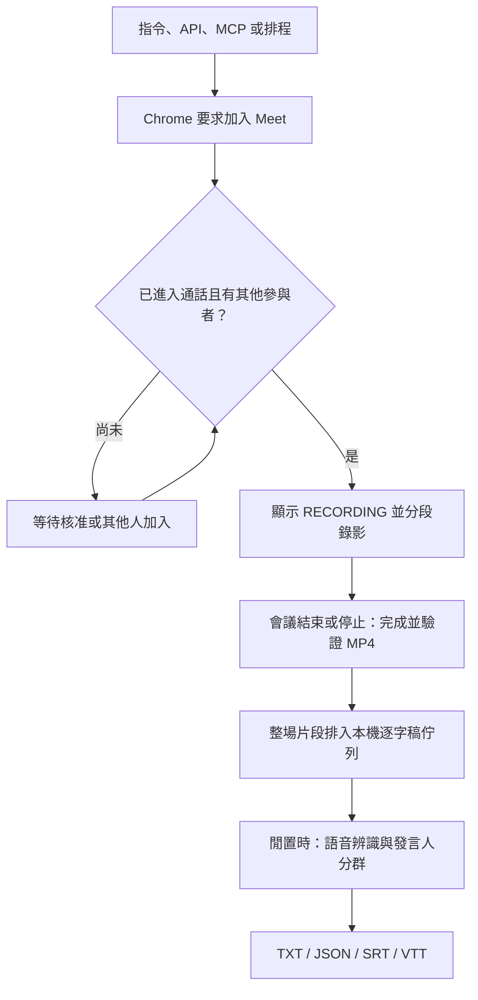
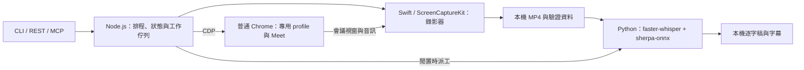

# Meeting Mate

在自己的 Mac 上，讓一位名叫 **Yumi** 的會議助手加入 Google Meet、錄下影音，並在會議結束後產生帶有發言人標籤的逐字稿。

使用普通 Google Chrome，不依賴 Playwright、OBS 或雲端轉寫服務。Google Meet 通話仍需連網；錄影檔案與語音模型推論留在本機。

> 錄影、REST API、MCP 與本機逐字稿流程已實作，原生合成影音與實際錄影片段的四格式輸出已驗證。**發言人分群仍屬實驗性**：實測有過度分群及錯誤合併，指定人數也不保證正確；請人工校對，不把 Speaker 標籤當成已確認身分。

[快速開始](#快速開始) · [查看逐字稿](#錄完後去哪裡看逐字稿) · [API 與 MCP](#用程式或-ai-工具操作) · [技術架構](#用了什麼技術) · [測試與限制](#如何驗證與排查問題)

## 它幫你做什麼？

| 想做的事 | 目前能力與界線 |
| --- | --- |
| 給一個 Meet 連結，立即加入 | CLI、API、MCP 皆可觸發；需要主持人核准時仍須等待 |
| 加入後自動錄影 | 確認進入通話才錄製；一次只處理一場會議 |
| 告知大家正在錄影 | 用合成相機顯示 `RECORDING` 提示卡，不開實體攝影機 |
| 暫停、恢復、結束 | 暫停仍留在會議；停止會完成檔案並離開 |
| 錄完得到文字與發言人 | 本機背景佇列產生 `Speaker 1／2`、時間戳及 TXT／JSON／SRT／VTT；品質驗證進行中 |
| 知道每個 Speaker 的真人姓名 | 尚未支援；聲音分群不等於姓名辨識 |
| Slack 指令、會後紀要與 Linear 跟進 | `pnpm dev:bind` 接收 `/meeting` 與訊息，交給既有 Yumi 整理；人工確認後建單，見 [Slack binding](docs/slack-binding.md) |
| 日曆、Zoom／Teams | 後續規劃，見 [Todo.md](Todo.md) |



等待有期限，拒絕入場、被移除或出錯也可能提前結束。錄影驗證失敗時不會冒充可用逐字稿；上述是成功流程。

## 用 Slack 叫 Yumi 加入會議

既有本機服務啟動後，在私有 `.env.yumi` 設定 Slack 憑證，執行 `pnpm dev:bind`。將自己的 HTTPS tunnel 轉到本機 `18007`，Slack `/meeting` 的 Request URL 設為 tunnel 網址加上 `/meeting`，即可使用 `/meeting <Google Meet 連結>`。

後續在 Slack thread 查看錄影、逐字稿與 Yumi 紀要；確認 `approve` 才建立 Linear 任務。完整設定、文字交接方式與使用界線見 [Yumi Meeting Mate：Slack binding](docs/slack-binding.md)。

## 快速開始

### 1. 準備環境與設定

需要 macOS 15+、Node.js 22+、pnpm、Google Chrome、FFmpeg／ffprobe，以及首次建置錄影器用的 Swift 編譯器。逐字稿安裝目前支援 **Apple Silicon Mac**，另需 `uv`，安裝前至少保留 2.5 GiB 空間；錄影還需要額外空間。

在專案目錄執行；`cp -n` 不會覆寫已有設定：

```sh
pnpm install
cp -n .env.example .env
cp -n config.example.json config.json
```

在 `.env` 設定訪客顯示名稱：

```dotenv
MEET_USERNAME=Yumi
```

這是**訪客名稱，不是 Google 登入帳號**。若會議要求登入，先在程式的專用 Chrome 視窗手動登入；帳號模式的名稱由 Google 帳號決定。程式不輸入密碼、不保證所有會議都允許訪客，也不略過主持人核准。

在 `config.json` 把 `meetingUrls` 換成自己的 Meet 連結。範例檔與本文件中的 `abc-defg-hij` 都是示意值，不是可用會議。

### 2. 首次準備錄影器與模型

**已安裝並授權的使用者跳過錄影器建置與重新授權**；一般 JavaScript／文件更新不需要重建原生 App。

```sh
# 僅首次安裝錄影器時需要
pnpm run build:recorder
pnpm run camera:prepare
pnpm run doctor --request-permission

# 首次啟用本機逐字稿
pnpm run transcript:setup
```

依 macOS 提示，在「系統設定 → 隱私權與安全性 → 螢幕與系統音訊錄製」允許 `Meeting Mate Recorder`。App 位於 `.meeting-mate/Meeting Mate Recorder.app`。不要為排查一般問題反覆重建／重簽，否則可能需要重新授權。

`camera:prepare` 準備提示卡與靜音輸入，必要時重啟專用 Chrome；只在沒有通話時執行。`transcript:setup` 下載約 532 MB 模型及獨立 Python 環境；之後轉寫使用本機模型，不上傳音訊。細節見 [逐字稿文件](docs/transcript.md)。

### 3. 啟動，再立即加入

選一種啟動方式，不要同時開兩份服務。前景執行時，終端機需保持開啟：

```sh
pnpm start
```

或安裝 macOS 登入後常駐的 LaunchAgent：

```sh
pnpm run install:launchd
```

服務啟動後，在另一個終端機觸發會議並查看狀態：

```sh
# 把示意連結換成自己的會議
pnpm run join:now https://meet.google.com/abc-defg-hij
curl http://127.0.0.1:8787/healthz
```

`queued` 只是受理，`waiting_approval` 表示等主持人放行，`recording` 才是錄影中。另一場會議正在加入或錄影時會拒絕新請求，不會把原會議踢掉。臨時輸入且不在設定檔中的連結只執行一次，不會加入固定排程。

### 4. 停止或更新

只結束目前會議、保留常駐服務：

```sh
curl http://127.0.0.1:8787/v1/meetings/stop \
  -H 'Content-Type: application/json' --data '{}'
```

停止整個常駐服務用 `pnpm run stop:launchd`。更新程式後需重啟服務時，用 `pnpm run upgrade:when-idle` 等會議結束再更新；不要在錄影中直接重跑 `install:launchd`，那會中止目前通話。

## 什麼時候錄影、什麼時候退出？

| 情況 | 預設行為 |
| --- | --- |
| 固定排程 | 每個設定連結每小時檢查一次，從上次嘗試開始計時 |
| 主持人尚未放行 | 最多等 15 分鐘；候場不錄影 |
| 進入後只剩助手一人 | 連續偵測 30 秒後完成錄影並離開；不是「一秒沒人說話就退出」 |
| 會議結束、拒絕或移除 | 停止錄影並清理會議頁面 |
| 長會議 | 每 10 分鐘一段 MP4；單次通話最多 12 小時 |
| 暫停錄影 | 完成當前片段、關閉提示相機，仍留在會議；恢復時開新片段 |

同一場的片段由 `sessionId` 串連。30 秒單人退出與 12 小時限制也適用於暫停狀態；人數取決於 Meet 頁面辨識，並非主持人端的官方結束通知。

`cameraIndicator: true` 顯示的是合成 **RECORDING 提示卡**，不是你的實體攝影機。麥克風預設靜音，並使用靜音虛擬輸入。請事先告知參與者錄影與轉寫；提示卡不是 Google Meet 原生錄影通知，也不代表已取得所有人的同意。

## 錄完後去哪裡看逐字稿？

錄影在 `recordings/`；逐字稿在 `transcripts/`。新會議結束且整場片段驗證完成後，預設自動排入轉寫。**不是停止錄影的瞬間就有文字**：CPU 推論需要時間，長會議可能等得更久。

服務一次處理一個轉寫工作，會議活動與錄影測試優先；忙碌時等待或暫停轉寫，閒置再繼續。可在 `config.json` 設定 `transcriptEnabled: false` 關閉自動轉寫，或用 `transcriptLanguage: "zh"` 指定中文（預設 `"auto"`）。

```sh
# 列出工作，從回應取得 id
curl http://127.0.0.1:8787/v1/transcripts

# 將 JOB_ID 換成實際工作 UUID
curl http://127.0.0.1:8787/v1/transcripts/JOB_ID
curl 'http://127.0.0.1:8787/v1/transcripts/JOB_ID/file?format=txt'
```

狀態依序為 `queued` → `running` → `completed` 或 `failed`；只有 `completed` 才有可下載結果。完成回應的 `downloads` 提供 TXT、JSON、SRT、VTT 位址：TXT 給人閱讀，JSON 給程式處理，SRT／VTT 給播放器當字幕。

可讀內容概念如下，**這是虛構示意，不是實際測試輸出**：

```text
[00:00:03 → 00:00:07] Speaker 1：我們先確認今天的議程。
[00:00:08 → 00:00:12] Speaker 2：好，我先說明測試結果。
```

`Speaker 1／2` 代表聲音群組，不代表真實姓名；同一工作共同分群以對齊跨片段標籤，不同工作的編號不能當成同一個人。短句、相似音色、雜音、中英切換與同時發言仍可能分錯或漏字，不保證 100% 準確，也不會把重疊發言分成獨立音軌。

舊錄影不會自動全部重跑。先從 `GET /v1/recordings` 取得已驗證的錄影 ID，再手動提交；以下 ID 只是示意：

```sh
curl http://127.0.0.1:8787/v1/transcripts \
  -H 'Content-Type: application/json' \
  --data '{"recordingId":"recording-001.mp4","language":"zh"}'
```

有 session 的錄影會處理該已結束 session 的全部片段；舊版沒有 session 的錄影只處理指定檔案。已知實際發言人數時可加 `numSpeakers`，但參與者人數不等於有說話的人數。詳見 [逐字稿文件](docs/transcript.md) 與 [MCP 範例](docs/mcp.md)。

## 用程式或 AI 工具操作

REST 是一般程式可呼叫的 HTTP 介面；MCP 則把同一套功能包成 AI client 能使用的工具。**兩者都連到同一個本機服務**，MCP 不會另開一套錄影器。

| 用途 | REST API | MCP 工具 |
| --- | --- | --- |
| 立即加入 | `POST /v1/meetings/join` | `meet_join` |
| 停止並離開 | `POST /v1/meetings/stop` | `meet_stop` |
| 暫停／恢復錄影 | `POST /v1/meetings/pause`、`POST /v1/meetings/resume` | `meet_pause`、`meet_resume` |
| 查狀態 | `GET /healthz`、`GET /v1/meetings` | `meet_status` |
| 找錄影 | `GET /v1/recordings`、`GET /v1/recordings/:id` | `recordings_list`、`recording_get` |
| 建立／查逐字稿 | `POST /v1/transcripts`、`GET /v1/transcripts`、`GET /v1/transcripts/:id` | `transcript_create`、`transcripts_list`、`transcript_get` |
| 錄影器診斷 | `GET /v1/diagnostics` | `recorder_diagnostics` |
| 啟動／查影音測試 | `POST /v1/recording-tests`、`GET /v1/recording-tests/:id` | `recording_test_start`、`recording_test_status` |

預設位址是 `http://127.0.0.1:8787`，OpenAPI 在 `/v1/openapi.json`。POST 使用 JSON；`202` 只表示已受理，需查狀態確認完成。完整參數、下載路徑及錯誤碼見 [API 文件](docs/api.md)。

支援 stdio 的 MCP client 可使用以下設定，把路徑換成實際專案位置：

```json
{
  "mcpServers": {
    "meeting-mate": {
      "command": "node",
      "args": ["/absolute/path/to/meeting-mate/src/mcp.mjs"]
    }
  }
}
```

若以 pnpm 啟動，使用 `pnpm --silent run mcp`，避免啟動訊息混入協定。先啟動主服務；完整設定見 [MCP 文件](docs/mcp.md)。API 與 Chrome CDP 僅供可信任的本機程式使用，沒有公網帳號驗證，**不要公開 8787／9222 連接埠**。

## 用了什麼技術？



| 元件 | 白話用途 | 主要位置 |
| --- | --- | --- |
| Node.js + `ws`／Chrome CDP | 控制普通 Chrome 頁面、加入會議及讀取狀態；不用 Playwright | `src/browser.mjs`、`src/meet-page.mjs`、`src/monitor.mjs` |
| Swift + ScreenCaptureKit | 使用 macOS 原生能力擷取會議視窗與音訊 | `native/Recorder.swift`、`src/recorder.mjs` |
| FFmpeg／ffprobe | 準備提示卡、檢查影音檔、抽出轉寫音訊 | `scripts/`、`src/recorder.mjs` |
| 本機 REST + MCP SDK／Zod | 提供 HTTP 與 MCP 工具，驗證操作參數 | `src/control-server.mjs`、`src/mcp.mjs` |
| Python + faster-whisper small | 把語音轉成文字；CPU、int8 模型 | `scripts/transcribe.py` |
| sherpa-onnx + 分段／聲音特徵模型 | 估計何時由哪個聲音群組發言 | `scripts/transcribe.py` |
| Node 逐字稿佇列與匯出 | 排隊、保存進度、整合片段、產生四種格式 | `src/transcripts.mjs`、`src/transcript-format.mjs` |

## 如何驗證與排查問題？

| 指令 | 驗證範圍／注意事項 |
| --- | --- |
| `pnpm test`、`pnpm run check` | Node 單元／模擬整合測試與語法檢查，不代表已錄到真實 Meet |
| `pnpm run test:mcp` | 真正 stdio MCP 子程序接模擬 API，不會加入會議 |
| `pnpm run test:transcript` | Python 邏輯與 Node 逐字稿工作測試，不代表模型辨識率 |
| `pnpm run doctor` | 檢查本機環境、錄影器及權限 |
| `pnpm run test:live` | 主服務啟動且閒置時，透過 MCP → API 錄約 10 秒合成動畫與測試音 |
| `pnpm run test:av` | 直接執行原生合成影音測試；僅在沒有會議活動時手動使用 |

已確認的合成影音結果：**2026-10-23（台北時間），MCP → API → 原生錄影器通過，10.061667 秒、H.264 視訊＋AAC 音訊**。本機證據為 `.meeting-mate/mcp-live-report.json`，不放進公開 repo。這證明本機錄影管線，不證明主持人核准、遠端多人音訊或真實逐字稿準確率；後者仍在驗證中。完整驗收分類見 [測試計畫](docs/test-plan.md)。

遇到問題，先看 `/healthz` 的 `state`／`detail`、`.meeting-mate/status.json` 與 `.meeting-mate/launchd.log`。逐字稿失敗則查看該 job 的 `error`；缺模型先執行 `transcript:setup`，再重新提交，不要把「已排隊」當成成功。

目前需要留意：

- 保持 Mac 登入圖形工作階段且不進入睡眠；合蓋、登出或關機不能保證持續錄製。
- 畫面選取會議 Chrome 視窗；音訊不保證能隔離單一分頁，避免專用 Chrome 同時播放其他內容。
- 換段、暫停或異常收尾可能有缺口，不承諾無縫長時錄影；12 小時是限制值，不是已通過的壓力測試。
- Meet 網頁控制項會變動，Google 登入、核准、人數判讀與新 UI 仍需實測。

## 隱私、公開 repo 與變更追蹤

程式碼發布於公開的 [ZoneTwelve/meeting-mate](https://github.com/ZoneTwelve/meeting-mate)。公開的是程式，不是使用者的會議內容；SSH remote 為 `git@github.com:ZoneTwelve/meeting-mate.git`。

公開內容只應包含程式、測試與匿名範例。`.gitignore` 排除 `.env`、本機 `config.json`、錄影、逐字稿、模型、Chrome profile／cookies、logs 與 `.meeting-mate/`。不要把真實會議連結、參與者資料或這些產物放進文件／commit；忽略規則不能取代提交前的內容稽核。

```sh
pnpm run repo:check       # 單次唯讀檢查 Git 狀態
pnpm run repo:status      # 查看追蹤狀態
pnpm run repo:watch       # 審查後明確安裝：預設每 30 分鐘檢查
pnpm run repo:watch:stop  # 停用追蹤
```

定期追蹤只寫本機狀態摘要，**不會自動 stage、commit、push、fetch 或執行測試**，也不操作錄影服務。功能完成後，由整合者執行測試、稽核選定檔案，再 commit／push；不是「時間到了就把所有修改公開」。詳見 [repository.md](docs/repository.md) 與 [AGENTS.md](AGENTS.md)。

進一步閱讀：[API](docs/api.md) · [MCP](docs/mcp.md) · [本機逐字稿](docs/transcript.md) · [需求與風險](docs/requirements.md) · [測試計畫](docs/test-plan.md) · [待辦](Todo.md)。
