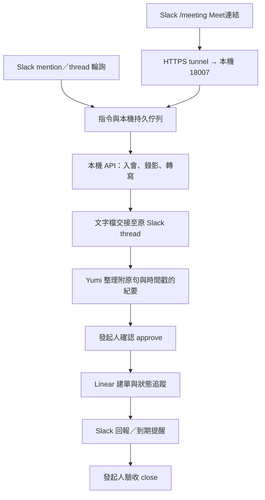

# Yumi Meeting Mate：Slack binding

`pnpm dev:bind` 把 Slack 指令、既有的本機錄影／逐字稿 API、線上 Yumi 與 Linear 接在一起。錄影與語音辨識仍在 Mac 執行。會後會將文字逐字稿複本上傳到發起指令的 Slack thread，交給既有 Yumi 整理；影音檔不會上傳。



## 啟動與 Slack 設定

先確認原有 Meeting Mate 服務已啟動。binder 是獨立程序，不會啟動、重建、重簽、重啟或停止原生錄影器；Ctrl-C 僅停止接收指令與跟進。

在被 Git 忽略的 `.env.yumi` 填入下列設定（以下全部是佔位值）：

```dotenv
USER_OAUTH_TOKEN=YOUR_SLACK_USER_TOKEN
BOT_USER_OAUTH_TOKEN=YOUR_SLACK_BOT_TOKEN
APP_ID=YOUR_SLACK_APP_ID
SIGNING_SECRET=YOUR_SLACK_SIGNING_SECRET
SLACK_BIND_PORT=18007

# 預設允許同 workspace 全員加入與停止會議；改成 owner 可限制為本人／allowlist。
SLACK_BIND_MEETING_ACCESS=workspace

# 可選：允許的頻道／其他操作的使用者 ID，以逗號分隔。
# 不填頻道則接收 bot 已加入的頻道與 DM；其他操作預設只允許 user token 的本人。
# SLACK_BIND_CHANNEL_IDS=CEXAMPLE
# SLACK_BIND_ALLOWED_USER_IDS=UEXAMPLE

# 建單與追蹤使用自己的 Linear API key。也可直接設 LINEAR_TOKEN。
# 指定既有 dotenv 檔時只讀取資料，不執行 shell 指令或變數展開。
# SLACK_BIND_LINEAR_ENV=/absolute/path/to/private.env
# SLACK_BIND_LINEAR_TEAM_ID=YOUR_LINEAR_TEAM_UUID
# SLACK_BIND_LINEAR_PROJECT_ID=YOUR_LINEAR_PROJECT_UUID
```

```sh
pnpm dev:bind --check
pnpm dev:bind
```

`--check` 只驗證憑證、Slack 讀取與本機連線，不發訊息、不開始會議。`--once` 跑一輪訊息處理，不啟動 HTTP listener；一般使用保持 `pnpm dev:bind` 在終端機執行。此功能不安裝 LaunchAgent。

在 Slack App 的 **Slash Commands** 新增 `/meeting`，Request URL 指向自己 tunnel 的 `https://YOUR-TUNNEL/meeting`。tunnel 只轉發 `127.0.0.1:18007`。先邀請同一個 Yumi bot 加入要使用的頻道；binder 以 bot 發送進度訊息，不會自行加入其他頻道。若尚未安裝 slash command 或變更 scopes，依 Slack 管理介面提示重新安裝 App。

另可新增 `/meeting-stop`，Request URL 設為 `https://YOUR-TUNNEL/meeting-stop`（也接受共用 `/meeting` URL）。在頻道主畫面輸入 `/meeting-stop` 或 `/meeting stop`，會送出本機目前會議／待入會工作的停止請求，不需要尋找原 thread；同 workspace 的任何人都可使用。停止會優先於尚未執行的加入指令，且不等待 Slack 訊息發送成功才停止本機工作。

18007 只提供 `POST /meeting`、`POST /meeting-stop` 與無資料的 `GET /healthz`，不代理錄影 API、Chrome debugging port 或本機檔案。請勿把既有 8787 或 9222 當成 tunnel 目標。接收器用原始 body 的 HMAC-SHA256、常數時間比較、五分鐘時效與 workspace／App／使用者檢查驗證請求；不使用舊 verification token。不保存 `response_url`、簽章或原始表單。

HTTP ACK 在本機保存指令後立即回覆 ephemeral 訊息，錄影及網路工作由背景 worker 執行。slash command 本身沒有 thread，因此 bot 會建立一則進度訊息，後續都回到該 thread。這不需要更改線上 Yumi 的 Event Subscription，也不會切換 Socket Mode。tunnel 與 Mac 必須保持連線；免費 tunnel 換網址後要更新 Slack Request URL。

## 指令

以下 Meet code 是虛構示意值，不是可用會議：

```text
/meeting https://meet.google.com/abc-defg-hij?pli=1
/meeting join https://meet.google.com/abc-defg-hij
/meeting status
/meeting-stop
```

`?pli=1` 等參數會移除，只使用經驗證的 Google Meet 網址。也可在 bot 已加入的頻道送出 `@Yumi 幫我錄影 <Meet 連結>`，或 `meeting-mate join <Meet 連結>`。普通聊天中單獨出現連結不會自動錄影。

在進度 thread 回覆以下任一指令（加上 `meeting-mate` 前綴最明確）：

| 指令 | 行為 |
| --- | --- |
| `status` | 本機連線、該串進度、實際會議狀態與任務連結 |
| `pause` / `resume` / `stop` | 操作綁定場次；stop 會離開並完成錄影檔 |
| `transcript` | 查看／恢復已完成逐字稿的交接 |
| `retry` | 明確重試未確認的入會，或失敗的轉寫與交接 |
| `approve` | 確認目前已送達的紀要草稿，建立 Linear action items |
| `follow TEST-123` | 綁定既有 Linear issue，也接受 issue URL |
| `unfollow` | 停止這串的 Linear 跟進提醒 |
| `close` | Linear 全部完成／取消後，由人確認驗收結案 |

`/meeting stop` 與 `/meeting-stop` 停止本機目前工作；指定 `/meeting stop --thread <thread_ts>` 則只操作該 thread 綁定的場次。`pause` 等其他 slash 控制指令只會在同頻道、同請求人只有一個可用會議 thread 時選中它；有多個時需回原 thread 操作，或明確指定 `--thread <thread_ts>`。新的 `/meeting <連結>` 會開新 thread；錄影器忙碌時拒絕另一場，不會取代正在進行的錄影。收到「已受理」不等於開始錄影，須等 `recording` 回報。

`/meeting <連結>` 會自動重新開啟已失效的舊頁面並嘗試加入，不會因歷史 `needs_login` 狀態拒絕新請求。真正停在 Google 登入頁時才提示登入；完成登入後會自動繼續。跳到 Workspace 介紹頁會視為離開會議，不把其中的「登入」文字當成會議要求。主畫面使用 slash 指令；Slack 不支援在 thread 使用自訂 slash command，thread 僅用一般文字 `meeting-mate …` 指令與回報。

預設同 workspace 全員可發起加入與停止，包括停止別人發起的會議。其他操作仍需 user token 本人或 `SLACK_BIND_ALLOWED_USER_IDS` 權限；在既有 thread 內還須是發起人或 token 本人。沒有建單權限的發起人需由 token 本人確認紀要及結案。`SLACK_BIND_MEETING_ACCESS=owner` 可將加入／停止也限制為本人或 allowlist。Yumi bot 只能交回紀要，不能替人 approve 或控制錄影。

## Yumi 交接與建單

binder 用 bot token 上傳逐字稿 JSON，再用 user token 在同 thread 發出帶有 `[Meeting Mate] 自動交接` 標記的 `@Yumi` 訊息。這個明確標記的自動訊息會以 token 本人的身分出現；它用來喚醒忽略 bot 訊息的既有線上 Yumi。設 `SLACK_BIND_HANDOFF=false` 可停用文字上傳及此訊息，逐字稿保留在本機。

Yumi 需要能讀取 Slack 附件，並在相同 thread 回覆**一則不包 code fence** 的資料訊息：

```text
meeting-mate minutes {"decisions":[],"openQuestions":[],"actions":[{"title":"事項","description":"內容與驗收條件","owner":null,"assigneeId":null,"dueDate":null,"evidence":[{"start":5,"quote":"這裡必須是逐字稿原句"}]}]}
```

`decisions` 與 `openQuestions` 的項目使用 `text`、`evidence`；每個 action 使用上例欄位。每條 evidence 的 `start` 是 segment 開始秒數，`quote` 必須出現在該時間的原文中。檢查只證明引用存在，不證明推論正確；草稿會顯示內容、負責人、Linear assignee UUID、期限及依據，仍需人工確認。過長草稿須由 Yumi 精簡後重送，不能略過顯示直接建單。

Speaker 編號不是已確認姓名。沒有明確負責人／日期就留 `null`；有 owner 文字也不會自動猜測 Linear 使用者。`assigneeId` 僅能使用已核對的 Linear UUID。紀要解析或依據不符時不建單；人可修正並重送同樣格式。

只有送達草稿後的 `approve` 才開始建單。每個 action 使用固定 UUID，請求逾時後先查既有 issue，再恢復剩餘項目，避免一次重試建立多份任務。建單範圍是配置的 team／project；描述附原 Slack thread、逐字稿工作 ID 與引用。已建單後修訂應直接更新既有 issue。

每五分鐘讀取 Linear 狀態，狀態變更時回報原 thread，到期未完成的事項預設每日提醒一次。不自動私訊其他人、不猜進度，也不根據口頭說法自動關閉任務。全部標記完成／取消後，請求人仍需檢查交付內容並 `close`；結案時會重新讀取 Linear 防止誤關已重開的工作。

## 輪詢、恢復與限制

- 頻道及已綁定 thread 預設每 30 秒讀取；mention／`meeting-mate` 搜尋每 300 秒補漏。使用 `assistant.search.context` 的 granular search scopes，不要求舊 `search:read`。
- 只處理第一次啟動之後的指令。以 Slack message timestamp 去重，保存分頁 cursor、時間水位與固定搜尋窗口；搜尋向前重疊十分鐘容納索引延遲。搜尋不是永久可靠的事件佇列，bot 未加入的頻道、長期未索引或 API 權限不足仍可能收不到，slash 是即時入口。
- 預設需要 bot 的 `chat:write`、`channels:read/history`、`groups:read/history`、`im:read/history`、`files:write/read`；user token 需要 `chat:write`、可讀 thread 的 history scopes 及所需範圍的 `search:read.public/private/im/mpim`。slash command 需要 `commands`。現有 Yumi 還須其原本的 mention/event scopes。
- 遇到 429 依 `Retry-After` 暫停該 API。發送中斷時先以固定訊息 ID／內容核對 Slack 紀錄，再重試；外部 API 無法提供完全的 exactly-once 保證，讀取權限或索引延遲仍會影響恢復。
- 狀態存於 `.meeting-mate/slack-bind/state.json`，目錄 `0700`、檔案 `0600`、原子更新，包含會議連結、紀要、綁定資料與待發文字，屬私有資料。單一程序鎖避免同一 checkout 重複接收；換 workspace／bot 時拒絕套用舊狀態。檔案上限 32 MiB；長期使用需在停止 binder 後人工封存已完成資料。
- 本機錄影 API 未連上時可先接收指令並回報失敗，服務恢復後用 `retry`。已開始的錄影不會因 binder 退出而停止。程序在 mutation 中斷時不盲目重送，會回報需確認的狀態。
- 目前每次查詢最近 100 份錄影／轉寫工作；很久以前、已超出列表的未交接場次需在本機人工處理。逐字稿與 Speaker 分群品質沿用 [transcript.md](transcript.md) 的限制。

可調整 `SLACK_BIND_POLL_SECONDS`（最低 15）、`SLACK_BIND_SEARCH_SECONDS`（最低 60）、`SLACK_BIND_REMIND_SECONDS`（最低 300）。`SLACK_BIND_PORT=0` 完全停用 HTTP 接收器，仍可輪詢。`SLACK_BIND_ENV` 可指定另一個私有 dotenv 檔。

## 驗證

```sh
pnpm test:bind
pnpm run check
pnpm dev:bind --check
```

單元與本機 HTTP 測試使用虛構資料、假的 Slack／Linear／錄影服務，涵蓋簽章、逾時重送、權限、完整狀態流程、證據校驗、固定 UUID、跨 session 保護與私有狀態。它們不等於真實 Meet 錄影或線上 Yumi 整理成功。實際整合驗收需另走一場經授權的會議，核對 Slack thread、完整本機逐字稿與 Linear 結果。

參考 Slack 官方文件：[Slash commands](https://docs.slack.dev/interactivity/implementing-slash-commands/)、[簽章驗證](https://docs.slack.dev/authentication/verifying-requests-from-slack/)、[Real-time search](https://docs.slack.dev/reference/methods/assistant.search.context/)、[外部檔案上傳](https://docs.slack.dev/reference/methods/files.getUploadURLExternal/)、[完成上傳](https://docs.slack.dev/reference/methods/files.completeUploadExternal/)、[Socket Mode](https://docs.slack.dev/apis/events-api/using-socket-mode/)。
