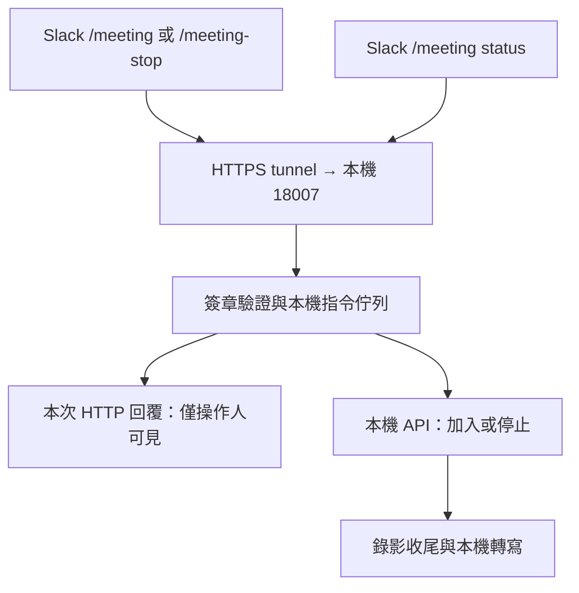

# Yumi Meeting Mate：Slack 指令

`pnpm dev:bind` 只接收 `/meeting` 與 `/meeting-stop`。每次指令透過原 HTTP 請求回覆操作人可見的 ephemeral 訊息，不建立頻道訊息或進度 thread。

錄影、影音驗證與轉寫仍由本機服務執行。binder 不讀取一般訊息、mention、DM 或 thread，不上傳逐字稿、不代替使用者喚醒 Yumi，也不執行 Linear 建單、追蹤或提醒。原本線上 Yumi 的 Event Subscription 與一般對話由原服務處理；binder 不修改其設定，也不切換 Socket Mode。



## 啟動與設定

先啟動原有 Meeting Mate 本機服務。binder 是獨立程序；啟動、停止或更新它不會重啟錄影器或轉寫程序。此功能不安裝 LaunchAgent。

在被 Git 忽略的 `.env.yumi` 填入以下設定（值皆為佔位值）：

```dotenv
BOT_USER_OAUTH_TOKEN=YOUR_SLACK_BOT_TOKEN
APP_ID=YOUR_SLACK_APP_ID
SIGNING_SECRET=YOUR_SLACK_SIGNING_SECRET
SLACK_BIND_PORT=18007

# 預設同 workspace 全員皆可加入、停止與查詢。
SLACK_BIND_MEETING_ACCESS=workspace

# 可選：限制允許的頻道，以逗號分隔。
# SLACK_BIND_CHANNEL_IDS=CEXAMPLE

# 可選：若改成 owner，需指定 allowlist，或以 user token 確認本人。
# SLACK_BIND_MEETING_ACCESS=owner
# SLACK_BIND_ALLOWED_USER_IDS=UEXAMPLE
# USER_OAUTH_TOKEN=YOUR_SLACK_USER_TOKEN
```

```sh
pnpm dev:bind --check
pnpm dev:bind
```

`--check` 只驗證 Slack 身分及本機連線，不讀取聊天或發訊息。`--once` 處理一次已保存的 slash 指令，不啟動 HTTP listener。一般使用保持 `pnpm dev:bind` 在終端機執行。Ctrl-C 僅停止接收器。

在 Slack App 的 **Slash Commands** 設定：

| Command | Request URL |
| --- | --- |
| `/meeting` | `https://YOUR-TUNNEL/meeting` |
| `/meeting-stop` | `https://YOUR-TUNNEL/meeting-stop` |

同一條 tunnel 轉發 `127.0.0.1:18007`，不要改動 Event Subscription 的 Request URL。接收器只提供這兩個 POST 路徑及無資料的 `GET /healthz`，不代理錄影 API、Chrome debugging port 或本機檔案。tunnel 與 Mac 必須保持連線；tunnel 網址變更後需更新兩個 slash Request URL。

此接收器只使用 bot token 的 `auth.test` 確認 workspace 與安裝身分；`owner` 未設定 allowlist 時另以 user token 的 `auth.test` 確認本人。不需要為它新增訊息搜尋、history、檔案上傳或 `chat:write` 權限。Slash commands 本身需要 `commands` scope；既有 Yumi 使用的權限保留由原服務管理。

## 使用

以下 Meet code 是虛構示意值：

```text
/meeting https://meet.google.com/abc-defg-hij?pli=1
/meeting join https://meet.google.com/abc-defg-hij
/meeting status
/meeting-stop
```

- `/meeting <連結>`：保存加入請求後回覆「已受理」，由本機背景 worker 呼叫錄影 API。移除 `?pli=1` 等參數，只接受經驗證的 Google Meet 網址。已有會議進行中時拒絕另開一場。
- `/meeting-stop`：停止本機目前會議或待入會請求，任何 workspace 成員皆可使用。也接受 `/meeting stop`。停止指令優先處理，取消尚未執行的加入請求，不依賴 Slack 發訊息是否成功。
- `/meeting status`：即時查詢目前會議狀態、最近三個轉寫工作的狀態／階段進度，以及本人在此頻道最近三次指令的結果。不顯示逐字稿內容、會議網址或本機檔案路徑。查詢逾時會在本次回覆提示稍後再查。
- `/meeting` 或 `/meeting help`：顯示用法。

「已受理」代表指令已保存在本機，並不代表成功入會、開始錄影或已完成停止。以 `/meeting status` 回報的實際狀態為準。轉寫百分比是當前階段的進度；階段 100% 不代表整份逐字稿已完成，`completed` 才是完成。

自訂 slash command 請在頻道主畫面使用。一般文字 `meeting-mate ...`、`@Yumi ...`、thread 回覆、`approve`、`follow` 等不再是此接收器的入口。登入與主持人准入仍沿用本機錄影服務流程；需要人工登入時在專用 Chrome 處理，再用 status 查詢。

停止會議後，已啟用的錄影收尾與自動轉寫由原本本機服務繼續，不依賴 binder。完成後透過 CLI、REST API 或 MCP 取得逐字稿，見 [transcript.md](transcript.md)。不會另發 Slack 完成通知、每 5% 更新或五分鐘心跳。

## 恢復與資料界線

- 使用原始 body 的 HMAC-SHA256、常數時間比較、五分鐘時效及 App／workspace／使用者檢查驗證請求。不保存 `response_url`、verification token、簽章或原始表單。
- 加入與停止指令保存成功才 ACK；以 trigger 衍生固定 ID 去重，再向本機 API 傳遞 idempotency key。重送同一請求不會建立另一場會議。
- 重啟後可恢復新版尚未執行的 slash 指令。執行途中中斷的操作不盲目重送，結果標為未確認；請先使用 status，再決定是否重新下指令。執行失敗也不自動重試。
- 升級時停用舊版待處理指令。舊 thread、outbox、逐字稿交接及 Linear 跟進資料保留在本機，但不恢復執行或補發訊息。既有錄影、轉寫與已建立的 Linear issue 保留。
- `.meeting-mate/slack-bind/state.json` 含私有操作與歷史資料，目錄 `0700`、檔案 `0600`、原子更新，不得提交 Git。單一程序鎖避免重複接收；換 workspace／bot 時拒絕載入舊狀態。上限 32 MiB，長期使用需在停止 binder 後人工封存。
- 舊 `SLACK_BIND_POLL_SECONDS`、`SLACK_BIND_SEARCH_SECONDS`、`SLACK_BIND_REMIND_SECONDS`、`SLACK_BIND_HANDOFF` 及 `SLACK_BIND_LINEAR_*` 設定不再啟用背景功能，也不讀取其指定的 Linear dotenv 檔。
- `SLACK_BIND_PORT=0` 停用 HTTP listener，僅處理已保存的新版 slash 指令；不改用 Slack 輪詢。`SLACK_BIND_ENV` 可指定另一個私有 dotenv 檔。

## 驗證

```sh
pnpm test:bind
pnpm run check
pnpm dev:bind --check
```

單元與本機 HTTP 測試使用虛構資料及假的錄影服務，涵蓋簽章、去重、保存失敗、workspace 權限、停止優先、背景靜默、舊資料恢復界線，以及狀態查詢逾時。測試不發送真實 Slack 訊息、不加入或停止真實 Meet，也不驗證語音辨識品質。

參考 Slack 官方文件：[Slash commands 與 HTTP 回覆](https://docs.slack.dev/interactivity/implementing-slash-commands/)、[簽章驗證](https://docs.slack.dev/authentication/verifying-requests-from-slack/)、[Events API Request URL](https://docs.slack.dev/apis/events-api/using-http-request-urls/)。
